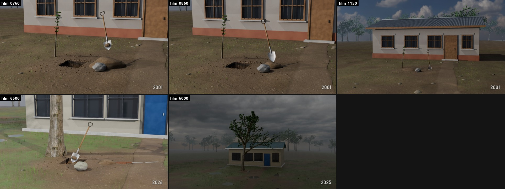

# Time Capsule - Computer Graphics Project

A Blender animation about a buried capsule and the passage of time from **2001 to 2026**. The courtyard, building, tree, weather, grass and ageing objects carry the story.

**Blender is an allowed implementation tool for this project.** The implementation uses Blender, its Python API and EEVEE. It does not claim to be a separately authored C++/OpenGL application.



## Open the project

1. Install **Git LFS** and run `git lfs install`.
2. Clone the repository:

   ```sh
   git clone https://github.com/nyam0s1/TimeCapsule_Graphics.git
   cd TimeCapsule_Graphics
   git lfs pull
   ```

3. Open **`TimeCapsule.blend` in Blender 5.2.x**. That is the authoritative, already-built scene; no rebuild script is needed to open it.
4. Use the timeline to inspect frames **1-7200**. Play or scrub the timeline to inspect animation and use the camera view to inspect framing. Rendered year labels and some atmospheric/compositing effects are best judged in rendered output.

The saved production configuration is **1920 x 1080, 24 fps, EEVEE, 32 samples**, with motion blur enabled. The planned full animation is five minutes. Interactive viewport playback may be slower than real time on modest hardware.

Large `.blend` and `.mp4` files use Git LFS. A small text file beginning `version https://git-lfs.github.com/spec/v1` is a pointer; fetch its contents with `git lfs pull`.

## Checkpoints and technical evidence

- [Phase 1, 2 and 3 answers](docs/CHECKPOINTS.md)
- [Graphics techniques mapped to scene components and source](docs/TECHNIQUES.md)
- [Current status, validation and remaining work](docs/PROJECT_STATUS.md)
- [Asset provenance](docs/ASSETS.md)
- [Publication file hashes](docs/FILE_MANIFEST.json)

## Animation evidence

| Evidence | What it demonstrates | Version context |
| --- | --- | --- |
| [Day/night and year-counter preview](renders/stills/time_pass_check/day_night_shot12_realspeed.mp4) | Time-varying sun, sky, exposure and year labels | TC13, 14 November; the later TC14 pass changed shovel geometry |
| [Continuous burial and reopening](renders/stills/no_human_check/continuous_burial_and_reopening.mp4) | Camera interpolation, capsule translation and lid rotation | Earlier TC9 motion preview; predates the later lighting/year/shovel changes |
| [Shovel filling and digging](renders/stills/no_human_check/shovel_fill_and_dig.mp4) | Shovel motion and soil work | Earlier TC10 motion preview; predates the later ageing/shape changes |
| [Latest film-frame examples](renders/stills/shovel_check/3_shovel_in_film_frames.jpg) | Updated shovel, environment, weather and year counter | TC14 saved-file evidence, 14 November |
| [Final-settings samples](renders/stills/time_pass_check/6_final_quality_from_saved_file.jpg) | Selected saved-file lighting/material checks | TC13 stills, not a complete final movie |

The existing full five-minute movie on the author's machine predates this scene revision and is deliberately not presented as the current final film. A complete final render and visual sign-off of the current version remain outstanding.

## Current implementation

- Procedural polygon meshes for environment and props, including a profiled digging blade/socket and an irregular soil pit.
- Translation, rotation, scaling, parent-child transforms, keyframes and driven properties.
- Monotone cubic camera-path interpolation (PCHIP) and smoothstep easing.
- Object-led burial/reopening, shovel work, tree/grass development and building changes.
- Time-driven rust, wood fading, stone lichen and paper/photo ageing.
- A solar-position and illumination model with time-compressed day/night transitions, restrained night lighting and a year counter.
- Materials, textures, lighting, shadows, atmospheric effects and camera projection through Blender's rendering workflow.

The current presentation omits a visible human. Hidden historical character data remains in the Blender file, but the submitted scene is an object/environment-led animation.

## Source scripts

The source scripts are kept beside their evidence under `renders/stills/` so their relative asset references remain clear. Additional historical generators are embedded in the Blender file's Text datablocks.

**The published scripts are guarded incremental authoring passes, not a clean rebuild pipeline.** They require particular earlier scene states. Their changes are already baked into the current `.blend`; do not run them blindly against it. For example, `time_pass.py` expects TC12 but no TC13 marker, and `shovel_shape.py` expects TC13 but no TC14 marker. `make_atlas.py` additionally requires Pillow and currently refers to a Windows font.

No personal backups, character-solver caches, internal agent notes, old full movies, or bulk PNG sequences are included.

## Rendering

Rendering is optional for opening/reviewing the source. With `blender` on the command path, this renders a single frame using the saved settings, with two CPU threads:

```sh
blender -b TimeCapsule.blend -t 2 -o //verification_output/frame_#### -f 1150
```

For the entire current animation:

```sh
blender -b TimeCapsule.blend -t 2 -o //verification_output/frame_#### -a
```

The full sequence is a substantial render job. Existing previews can be reviewed without launching it. The publication process did not render or resave the Blender scene.
