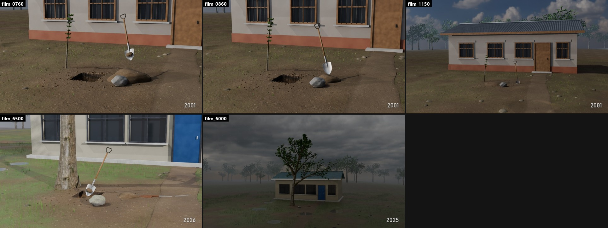

# Phase 1, 2 and 3 checkpoint answers

Project: **Time Capsule**. Status consolidated on **16 November 2026**. The week labels below are the scheduled checkpoints; the evidence describes the current saved implementation and is not a backdated record of feature completion.

Blender is allowed for this project. The answers therefore describe the actual Blender/Python implementation and do not treat a separate C++ port as a required unfinished task. No custom OpenGL application or hand-coded rasterizer is claimed.

## Phase 1 - Design and Foundations

Scheduled week: **2 November 2026**.

### What are we building?

We are building **Time Capsule**, a five-minute 3D animation about a capsule being buried and rediscovered after 25 years. Changes to the courtyard, house, tree, grass, weather and objects communicate the passage from 2001 to 2026. The current presentation is driven by objects and the environment, with no visible human character.

### What graphics concepts will we use?

We use points, edges and polygon faces to construct meshes; geometric primitives for simplified components; curves and splines for smooth movement; translation, rotation and scaling; hierarchical transforms; camera projection; materials and texture mapping; lighting and shadows; and time-based animation.

Examples include translating the capsule, rotating the lid about its hinge, scaling vegetation, moving the camera along a smooth path, and changing light/material parameters over time.

### What have we completed?

We have defined the story and scene components, assembled a complete Blender scene, developed the main props and environment, and established the animation timeline. The scene contains the capsule, photograph, shovel, marker, pit, house, terrain, vegetation and weather/lighting systems. The saved timeline contains 7200 frames at 24 fps.

### What are we doing next?

We are checking that each major component clearly demonstrates the intended graphics technique, improving visual clarity where needed, and preparing annotated evidence and the final demonstration. The current model and its supporting authoring scripts are available in the repository.

## Phase 2 - Build the Graphics

Scheduled week: **9 November 2026**. This section also covers transformations and animation because the supplied CP2 progression includes them.

### What algorithms have been implemented?

The implemented techniques include:

- **Procedural polygon construction:** parameterised vertices, ring/profile sampling and connected faces for objects such as the shovel blade/socket and the pit walls/floor.
- **PCHIP interpolation:** monotone piecewise cubic camera paths that avoid unwanted overshoot.
- **Smoothstep easing:** smooth starts and stops for capsule, lid, marker and environmental changes.
- **Keyframed transforms and drivers:** time-varying object position, rotation, scale, visibility and material/light properties.
- **Ageing calculations:** time-controlled noise masks and material changes for rust, faded wood, lichen and paper/photo ageing.
- **Solar lighting calculations:** sun direction, atmospheric attenuation, diffuse sky/twilight factors and time remapping for the day/night sequence.

These are implemented through Python and Blender. Rasterisation, clipping, shading and texture sampling are handled by Blender's renderer; we do not claim to have written DDA, Bresenham or boundary-fill implementations.

### Screenshot of the current scene

These TC14 examples show the latest shovel geometry, pit, vegetation, weather and year labels. [Shovel close-ups](../renders/stills/shovel_check/2_shovel_closeups_after.jpg) provide additional mesh/detail evidence.

### GitHub link

https://github.com/nyam0s1/TimeCapsule_Graphics

### What remains?

We need to finish reviewing the latest day/night sequence in motion, check readability in dark shots, address any remaining geometry/material issues found during that review, and complete the final demonstration evidence. The current complete-film render is still pending; older previews are labelled with their version context.

## Phase 3 - Transform and Animate / OpenGL Integration

Scheduled week: **16 November 2026**.

### Current OpenGL implementation

Our allowed implementation environment is **Blender**, with Python automation and EEVEE rendering. We demonstrate scene geometry, object/camera transformations, perspective, materials, lighting and animated properties within Blender's graphics workflow.

We have not written a separate OpenGL program or exposed a custom OpenGL API/render loop. The checkpoint evidence is the Blender project, its scripts and rendered output; it should be described at that level.

### Animation/interaction evidence

- [Day/night preview](../renders/stills/time_pass_check/day_night_shot12_realspeed.mp4): sun/sky changes, time remapping and year labels.
- [Continuous burial/reopening preview](../renders/stills/no_human_check/continuous_burial_and_reopening.mp4): camera movement, capsule translation and lid rotation. This is an earlier motion preview, not the latest complete visual state.
- [Shovel work preview](../renders/stills/no_human_check/shovel_fill_and_dig.mp4): filling and digging movement, also from an earlier pass.
- [Storm preview](../renders/stills/storm_branches_check/storm_5370_5440.mp4): lightning shown as a glow inside the clouds; the scene itself is no longer flash-lit (low-resolution preview).
- [Background tree regrowth preview](../renders/stills/storm_branches_check/trees_regrow_3900_4500_x2.mp4): background trees lose limbs in the drought and regrow them in the wet years, driven by Geometry Nodes (twice speed, low resolution).
- Weather/branch scripts: [weather_pass.py](../renders/stills/weather_check/weather_pass.py), [cloud_flow.py](../renders/stills/weather_check/cloud_flow.py), [storm_branches.py](../renders/stills/storm_branches_check/storm_branches.py).
- **Blender interaction:** timeline playback/scrubbing and viewport/camera inspection allow the scene and animated changes to be demonstrated. No custom game controls are claimed.

The latest saved version also includes vegetation growth/seasonal changes, object ageing, an old shovel's fall/breakage and a year counter. Not every latest feature has completed a full motion review.

### GitHub link

https://github.com/nyam0s1/TimeCapsule_Graphics

### What remains?

We need to review the complete latest animation at normal playback speed, verify transitions and year/night readability, correct any issues found, render the current full sequence at the saved 1080p/32-sample settings, encode and verify the final MP4, and prepare the Phase 4 demonstration explaining what works and any remaining limitations.
